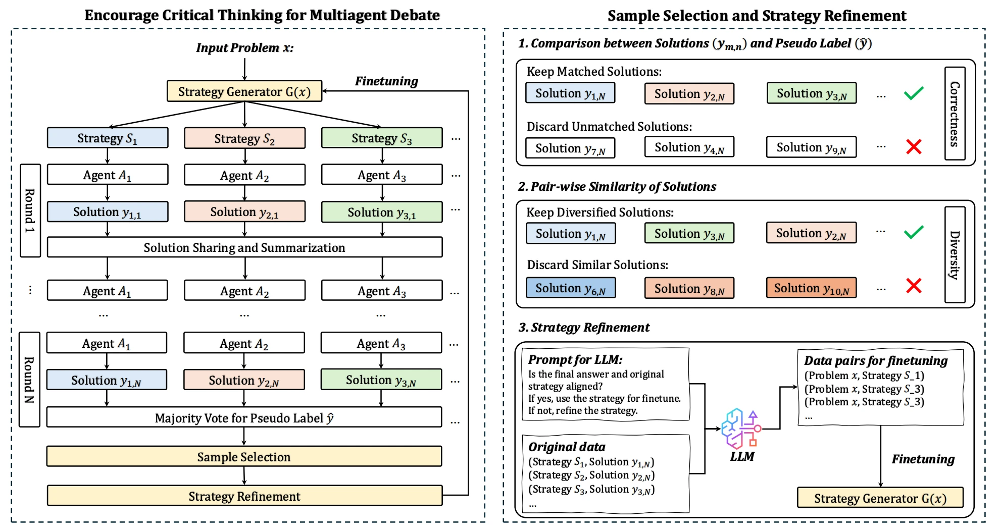

# CMAD (Unofficial Implementation)

Unofficial implementation of "Unfixing the Mental Set: Granting Early-Stage Reasoning Freedom in Multi-Agent Debate" (CMAD).

<p align="center">
  
</p>

## Repo structure

```
cmad/                # Core library: debate orchestration, strategy generation,
                      # selection, LoRA self-training, evaluation
scripts/              # Dataset prep, the main driver, and results plotting
tests/                # Pure-CPU, zero network/GPU tests
real_run_cmad.sh      # Entrypoint
```

## Installation

Requires 2 GPUs: one serves vLLM, the other runs LoRA fine-tuning (GPU 0 and 1 by default; set `VLLM_GPU` / `TRAIN_GPU` to change).

```bash
pip3 install vllm==0.11.0
pip3 install "https://github.com/Dao-AILab/flash-attention/releases/download/v2.8.3.post1/flash_attn-2.8.3.post1+cu12torch2.8cxx11abiTRUE-cp312-cp312-linux_x86_64.whl"
pip3 install -r requirements.txt   # pins transformers==4.57.3; install this last
```

## Quick start

**Local tests.** No network, no GPU.

```bash
for f in tests/test_*.py; do python3 "$f"; done
```

**Quick run.** About 25 GSM8K questions, to check the setup end to end.

```bash
export TRAIN_POOL_SIZE=25 EVAL_SIZE=25 NUM_ITERATIONS=1 DATASET=gsm8k
bash real_run_cmad.sh
```

**Full run.**

```bash
export TRAIN_POOL_SIZE=300 EVAL_SIZE=500 NUM_ITERATIONS=4 DATASET=gsm8k   # or DATASET=math
bash real_run_cmad.sh
```

`real_run_cmad.sh` lists all its environment variables at the top. `scripts/run_cmad_full.py --help` lists every CLI flag; extra flags can be passed via `EXTRA_RUN_CMAD_FLAGS`. Each iteration's trained LoRA adapter is written to `run_adapters/`, per-condition accuracy to `results/`.
